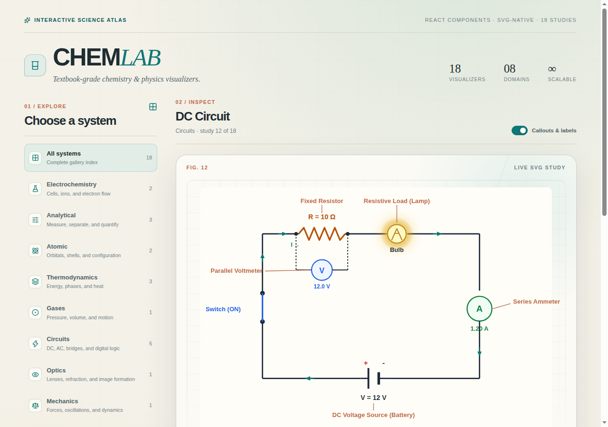
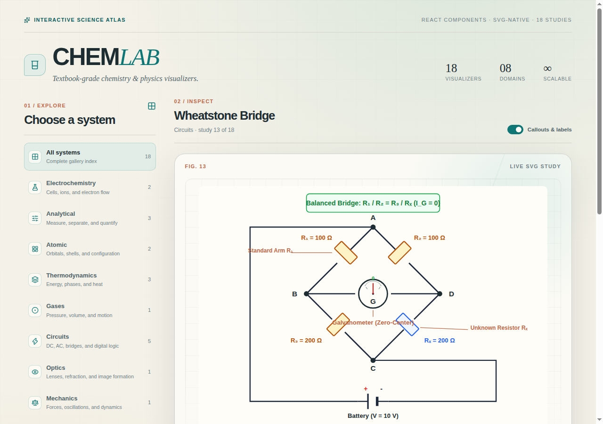
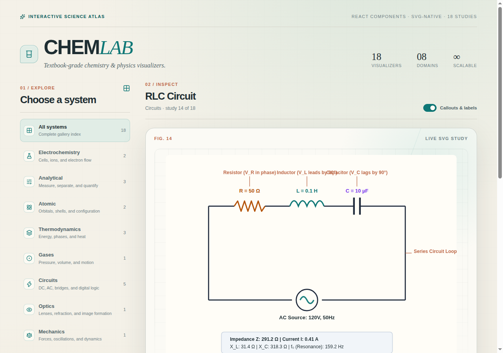
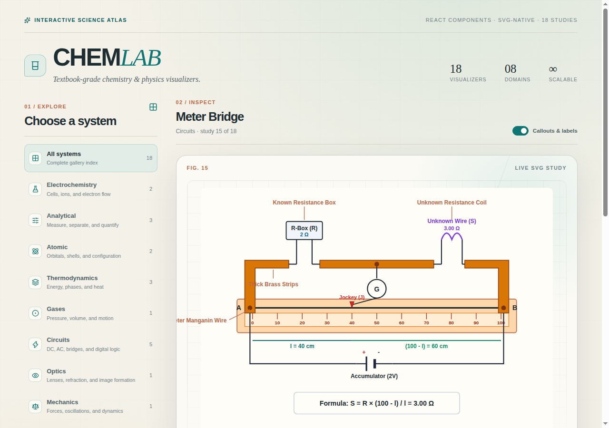
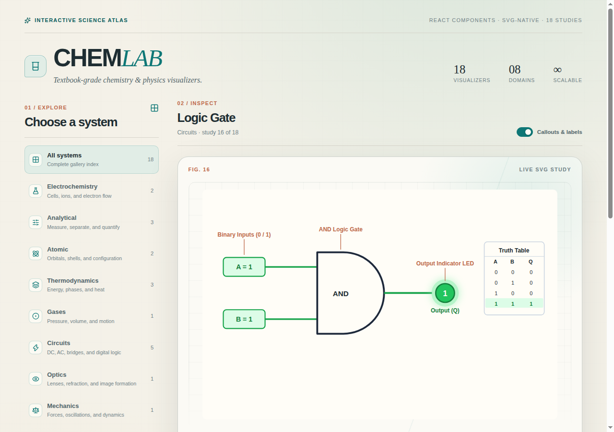
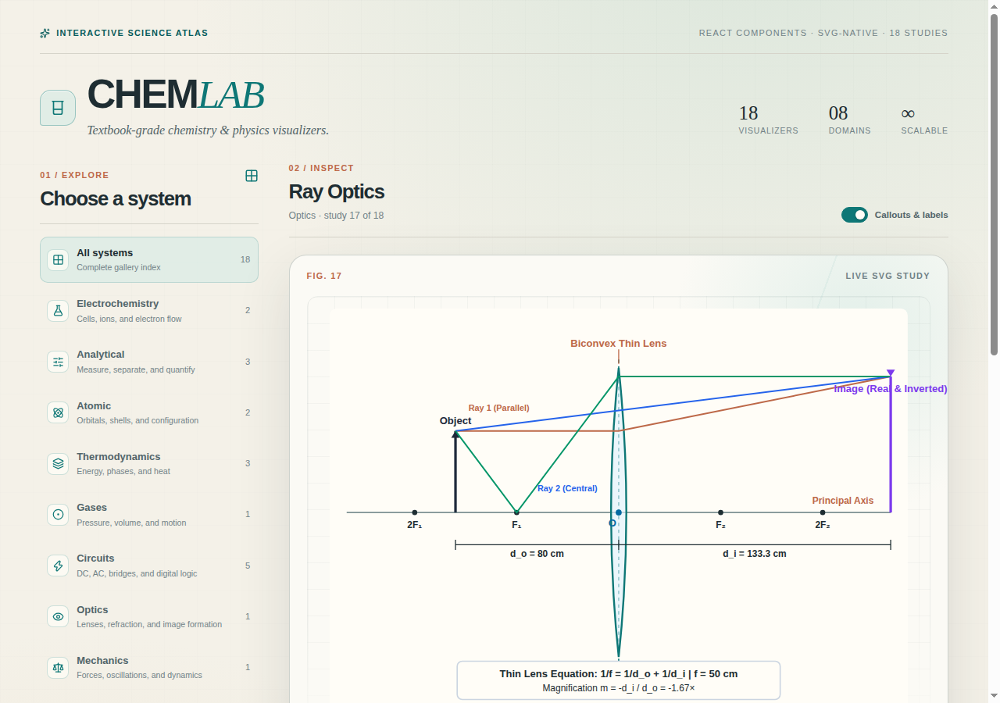
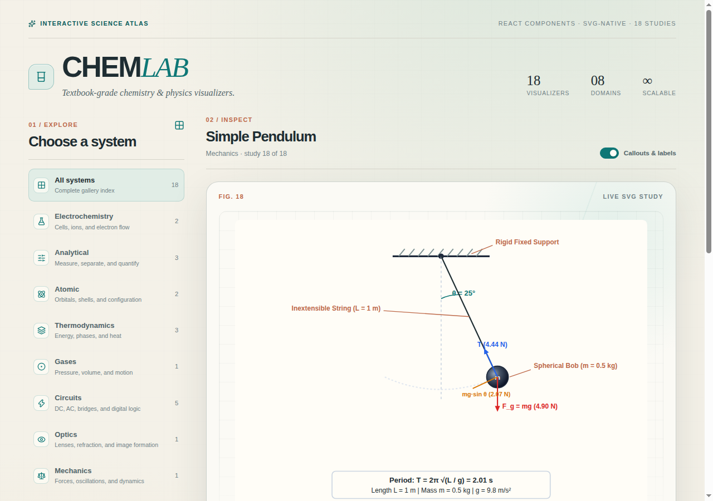

# react-chemlab

[](https://opensource.org/licenses/MIT)
[](https://www.typescriptlang.org/)
[](https://react.dev/)
[](https://tailwindcss.com/)

A modular suite of **textbook-grade chemistry & physics apparatus and circuit visualizers** for React. Built with pure scalable vector graphics (SVG) and TypeScript, designed specifically for STEM education platforms, digital textbooks, online quizzes, and interactive scientific applications.

---

## ✨ Features

- **Textbook Quality**: Crisp, vector-rendered lab apparatus and schematics matching collegiate and high-school STEM curriculum diagrams.
- **Pure SVG Rendering**: Infinite scalability without pixelation or heavy raster dependencies.
- **Diagram-Only Focus**: Renders purely the visual apparatus or circuit without forced wrappers, sidebars, or headers.
- **Configurable Annotations**: Toggle leader callout lines, labels, measurement scales, and current flows with single props.
- **Strongly Typed**: 100% TypeScript with comprehensive interfaces for each visualizer.
- **Zero Runtime Dependencies**: Lightweight and responsive SVG viewboxes that scale naturally to any container or screen size.

---

## 🔬 Chemistry Visualizer Showcase

| Visualizer | Preview | Description |
| :--- | :--- | :--- |
| **Galvanic Cell** |  | Standard electrochemical cell ($Zn/Cu$), porous salt bridge, digital voltmeter LCD, elevated wiring, optional electron flow banners and callouts. |
| **Electrolytic Cell** |  | Hoffman / U-tube water electrolysis apparatus ($2\text{H}_2\text{O} \rightarrow 2\text{H}_2 + \text{O}_2$), calibrated gas collection tubes (2:1 stoichiometric volume ratio), DC power source. |
| **Titration Setup** |  | Precision analytical burette, graduated volume markings, stopcock valve, Erlenmeyer flask, phenolphthalein endpoint indicator color, magnetic stir plate. |
| **Spectrophotometer** |  | Complete optical schematic: tungsten light source, collimating lens, diffraction prism, wavelength selector slit, sample cuvette, photodetector with digital Absorbance & Transmittance readouts. |
| **Paper Chromatography** |  | Sealed developing chamber, solvent reservoir, TLC / filter paper strip, solvent front, separated pigment spots with calculated $R_f$ retention factors. |
| **Bohr Model** |  | Quantized electron shells ($n=1, 2, \dots$), proton/neutron nucleus, paired orbital electrons, emitted / absorbed quantum photon packets ($h\nu$). |
| **Orbital Diagram** |  | Electron configuration energy diagram following Aufbau principle, Hund's rule, and Pauli exclusion principle ($1s, 2s, 2p, 3s, 3p, 3d, 4s$) with spin arrows ($\uparrow\downarrow$). |
| **Calorimeter** |  | Constant-pressure coffee cup calorimeter, double nested polystyrene insulated cups, tight lid, lab thermometer, glass stirrer, water bath ($q = mc\Delta T$). |
| **Reaction Energy Profile** |  | Reaction progress coordinate vs Potential Energy curve, activation energy ($E_a$), enthalpy change ($\Delta H$), activated complex transition state ($[^\ddagger]$), catalyzed alternative pathway. |
| **Phase Diagram** |  | Pressure-Temperature phase equilibrium boundaries for Solid, Liquid, Gas states, Triple Point, Critical Point, and negative-slope fusion curve for water. |
| **Gas Piston** |  | Ideal gas law thermodynamics cylinder ($PV = nRT$), weighted piston head, dual pressure / temperature gauge, heat source, bounded kinetic gas particles. |

---

## ⚡ Physics & Circuit Visualizer Showcase

| Visualizer | Preview | Description |
| :--- | :--- | :--- |
| **DC Circuit** |  | Complete DC loop with battery voltage source, toggle knife switch, fixed resistor, incandescent bulb with radiant illumination, inline ammeter, parallel voltmeter, and current flow arrows. |
| **Wheatstone Bridge** |  | Four-resistor bridge network ($R_1, R_2, R_3, R_x$), central zero-center Galvanometer with realistic deflection needle, DC battery, and balance condition verification ($R_1 R_x = R_2 R_3$). |
| **RLC Circuit** |  | Series AC circuit with sinusoidal source, resistor $R$, multi-turn inductor coil $L$, parallel-plate capacitor $C$, and real-time calculation of impedance $Z$, reactances ($X_L, X_C$), and resonance frequency $f_0$. |
| **Meter Bridge** |  | One-meter slide wire bridge on wooden baseboard, calibrated millimeter scale (0–100 cm), thick brass strips, resistance box $R$, unknown wire $S$, sliding contact jockey, and null point equation. |
| **Logic Gate Circuit** |  | Digital electronics logic schematics (AND, OR, NAND, NOR, XOR, NOT), interactive binary toggles (0/1), color-coded signal rails, glowing LED probe, and synchronized truth table. |
| **Ray Optics** |  | Geometric optics thin lens schematic (convex/concave), principal axis, optical center $O$, focal points ($F_1, 2F_1, F_2, 2F_2$), three traced principal rays, real inverted image, and lens formula. |
| **Simple Pendulum** |  | Classical mechanics pendulum with rigid support ceiling, string length $L$, mass bob $m$, deflection angle $\theta$, oscillation trajectory arc, resolved force vectors ($mg\sin\theta, mg\cos\theta, T$), and period $T = 2\pi\sqrt{L/g}$. |

---

## 🚀 Getting Started

### Installation

```bash
npm install react-chemlab
```

### Basic Usage

Import chemistry or physics components directly and embed them in your React application:

```tsx
import {
  GalvanicCell,
  TitrationSetup,
  DCCircuit,
  WheatstoneBridge,
  LogicCircuit,
  RayOptics,
  SimplePendulum
} from 'react-chemlab'

export function ScienceDashboard() {
  return (
    <div className="grid grid-cols-1 md:grid-cols-2 gap-8 p-6">
      <DCCircuit
        voltage={12}
        resistance={10}
        switchClosed={true}
        showVoltmeter={true}
        showAmmeter={true}
        showBulb={true}
        showCallouts={true}
      />

      <WheatstoneBridge
        r1={100}
        r2={100}
        r3={200}
        rx={200}
        voltage={10}
        showGalvanometerDeflection={true}
        showBalanceEquation={true}
      />

      <LogicCircuit
        gateType="AND"
        inputA={1}
        inputB={1}
        showTruthTable={true}
        showCallouts={true}
      />

      <RayOptics
        lensType="convex"
        focalLength={50}
        objectDistance={80}
        objectHeight={40}
        showRays={true}
        showFormula={true}
      />

      <SimplePendulum
        stringLength={1.0}
        angleDegrees={25}
        bobMass={0.5}
        showForceVectors={true}
        showFormula={true}
      />

      <GalvanicCell
        anodeElement="Zn"
        cathodeElement="Cu"
        voltage={1.10}
        showCallouts={true}
      />
    </div>
  )
}
```

---

## 📖 Component API Reference

### Physics & Circuits

#### `<DCCircuit />`

```tsx
interface DCCircuitProps {
  voltage?: number
  resistance?: number
  switchClosed?: boolean
  showVoltmeter?: boolean
  showAmmeter?: boolean
  showBulb?: boolean
  showCallouts?: boolean
  showCurrentFlow?: boolean
  animated?: boolean
  width?: number | string
  height?: number | string
  className?: string
}
```

#### `<WheatstoneBridge />`

```tsx
interface WheatstoneBridgeProps {
  r1?: number
  r2?: number
  r3?: number
  rx?: number
  voltage?: number
  showGalvanometerDeflection?: boolean
  showBalanceEquation?: boolean
  showCallouts?: boolean
  width?: number | string
  height?: number | string
  className?: string
}
```

#### `<RLCCircuit />`

```tsx
interface RLCCircuitProps {
  resistance?: number
  inductance?: number
  capacitance?: number
  frequency?: number
  voltage?: number
  showPhasorSummary?: boolean
  showCallouts?: boolean
  animated?: boolean
  width?: number | string
  height?: number | string
  className?: string
}
```

#### `<MeterBridge />`

```tsx
interface MeterBridgeProps {
  resistanceR?: number
  balanceLengthL?: number
  unknownResistanceS?: number
  driverVoltage?: number
  showCallouts?: boolean
  showFormula?: boolean
  width?: number | string
  height?: number | string
  className?: string
}
```

#### `<LogicCircuit />`

```tsx
interface LogicCircuitProps {
  gateType?: 'AND' | 'OR' | 'NAND' | 'NOR' | 'XOR' | 'NOT'
  inputA?: 0 | 1
  inputB?: 0 | 1
  showTruthTable?: boolean
  showCallouts?: boolean
  width?: number | string
  height?: number | string
  className?: string
}
```

#### `<RayOptics />`

```tsx
interface RayOpticsProps {
  lensType?: 'convex' | 'concave'
  focalLength?: number
  objectDistance?: number
  objectHeight?: number
  showRays?: boolean
  showLabels?: boolean
  showCallouts?: boolean
  showFormula?: boolean
  width?: number | string
  height?: number | string
  className?: string
}
```

#### `<SimplePendulum />`

```tsx
interface SimplePendulumProps {
  stringLength?: number
  angleDegrees?: number
  bobMass?: number
  showForceVectors?: boolean
  showTrajectoryArc?: boolean
  showFormula?: boolean
  showCallouts?: boolean
  width?: number | string
  height?: number | string
  className?: string
}
```

---

### Chemistry

#### `<GalvanicCell />`

```tsx
interface GalvanicCellProps {
  anodeElement?: string
  cathodeElement?: string
  anodeConcentration?: number
  cathodeConcentration?: number
  voltage?: number
  showLabels?: boolean
  showCallouts?: boolean
  showElectronFlow?: boolean
  animated?: boolean
  width?: number | string
  height?: number | string
}
```

#### `<ElectrolyticCell />`

```tsx
interface ElectrolyticCellProps {
  voltage?: number
  current?: number
  electrolyte?: string
  anodeReaction?: string
  cathodeReaction?: string
  showLabels?: boolean
  showCallouts?: boolean
  animated?: boolean
  width?: number | string
  height?: number | string
}
```

#### `<TitrationSetup />`

```tsx
interface TitrationSetupProps {
  titrant?: string
  analyte?: string
  buretteVolume?: string
  endpointReached?: boolean
  indicatorColor?: string
  showStirrer?: boolean
  showDroplets?: boolean
  showCallouts?: boolean
  animated?: boolean
  width?: number | string
  height?: number | string
}
```

#### `<Spectrophotometer />`

```tsx
interface SpectrophotometerProps {
  wavelength?: number
  absorbance?: number
  transmittance?: number
  sampleName?: string
  sampleColor?: string
  showCallouts?: boolean
  animated?: boolean
  width?: number | string
  height?: number | string
}
```

#### `<PaperChromatography />`

```tsx
interface PaperChromatographyProps {
  spots?: Array<{
    name: string
    rf: number
    color: string
  }>
  solvent?: string
  solventFront?: number
  showCallouts?: boolean
  animated?: boolean
  width?: number | string
  height?: number | string
}
```

#### `<BohrModel />`

```tsx
interface BohrModelProps {
  element?: string
  symbol?: string
  atomicNumber?: number
  shells?: number[]
  protons?: number
  neutrons?: number
  showQuantumJump?: boolean
  jumpShell?: number
  showCallouts?: boolean
  animated?: boolean
  width?: number | string
  height?: number | string
}
```

#### `<OrbitalDiagram />`

```tsx
interface OrbitalDiagramProps {
  element?: string
  electronConfiguration?: string
  subshells?: Array<{
    name: string
    boxes: number
    electrons: number
    energyLevel: number
  }>
  showCallouts?: boolean
  width?: number | string
  height?: number | string
}
```

#### `<Calorimeter />`

```tsx
interface CalorimeterProps {
  reactionType?: string
  initialTemp?: number
  finalTemp?: number
  massWater?: number
  heatCapacity?: number
  heatExchange?: number
  showCallouts?: boolean
  animated?: boolean
  width?: number | string
  height?: number | string
}
```

#### `<ReactionEnergyProfile />`

```tsx
interface ReactionEnergyProfileProps {
  reactantEnergy?: number
  productEnergy?: number
  activationEnergy?: number
  catalyzedActivationEnergy?: number
  showCatalyst?: boolean
  reactionLabel?: string
  showCallouts?: boolean
  width?: number | string
  height?: number | string
}
```

#### `<PhaseDiagram />`

```tsx
interface PhaseDiagramProps {
  substance?: string
  triplePointTemp?: number
  triplePointPress?: number
  criticalPointTemp?: number
  criticalPointPress?: number
  isWater?: boolean
  showCallouts?: boolean
  width?: number | string
  height?: number | string
}
```

#### `<GasPiston />`

```tsx
interface GasPistonProps {
  pressure?: number
  volume?: number
  temperature?: number
  gasName?: string
  particleCount?: number
  hasFlame?: boolean
  showCallouts?: boolean
  animated?: boolean
  width?: number | string
  height?: number | string
}
```

---

## 🛠️ Development & Interactive Playground

Clone this repository to run the local interactive laboratory and test each component live:

```bash
git clone https://github.com/adhil72/react-chemlab.git
cd react-chemlab
npm install
npm run dev
```

The interactive gallery will run at `http://localhost:5173/`, allowing you to inspect each study across chemistry, circuits, optics, and mechanics.

To run lint checks and production builds:

```bash
npm run lint
npm run build
```

---

## 📄 License

[MIT](LICENSE) © [adhil72](https://github.com/adhil72)
