# react-chemlab

[](https://opensource.org/licenses/MIT)
[](https://www.typescriptlang.org/)
[](https://react.dev/)
[](https://tailwindcss.com/)

A modular suite of **textbook-grade chemistry apparatus and reaction visualizers** for React. Built with pure scalable vector graphics (SVG) and TypeScript, designed specifically for STEM education platforms, digital textbooks, online quizzes, and interactive scientific applications.

---

## ✨ Features

- **Textbook Quality**: Crisp, vector-rendered lab apparatus matching standard collegiate and high-school chemistry textbook diagrams.
- **Pure SVG Rendering**: Infinite scalability without pixelation or heavy raster dependencies.
- **Diagram-Only Focus**: Renders purely the visual apparatus without forced wrappers, sidebars, or headers.
- **Configurable Annotations**: Toggle leader callout lines, chemical labels, measurement scales, and electron flows with single props.
- **Strongly Typed**: 100% TypeScript with comprehensive interfaces for each visualizer.
- **Accessible & Responsive**: Built with SVG viewboxes that scale naturally to any container or screen size.

---

## 🔬 Component Showcase

| Visualizer | Preview | Description |
| :--- | :--- | :--- |
| **Galvanic Cell** | 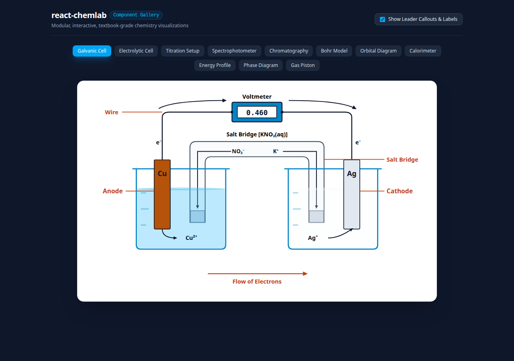 | Standard electrochemical cell ($Zn/Cu$), porous salt bridge, digital voltmeter LCD, elevated wiring, optional electron flow banners and callouts. |
| **Electrolytic Cell** | 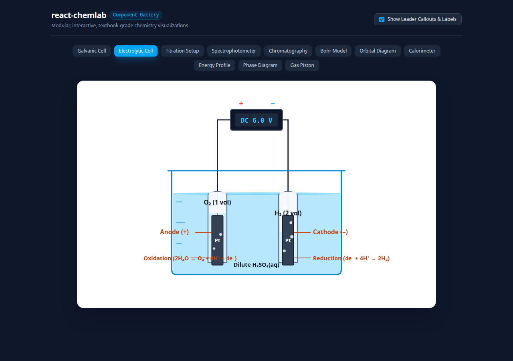 | Hoffman / U-tube water electrolysis apparatus ($2\text{H}_2\text{O} \rightarrow 2\text{H}_2 + \text{O}_2$), calibrated gas collection tubes (2:1 stoichiometric volume ratio), DC power source. |
| **Titration Setup** | 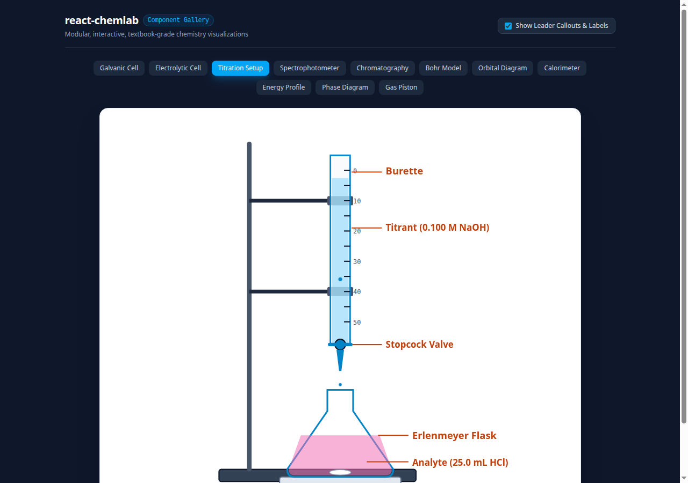 | Precision analytical burette, graduated volume markings, stopcock valve, Erlenmeyer flask, phenolphthalein endpoint indicator color, magnetic stir plate. |
| **Spectrophotometer** | 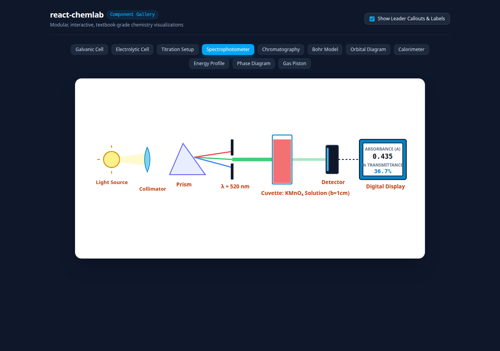 | Complete optical schematic: tungsten light source, collimating lens, diffraction prism, wavelength selector slit, sample cuvette, photodetector with digital Absorbance & Transmittance readouts. |
| **Paper Chromatography** | 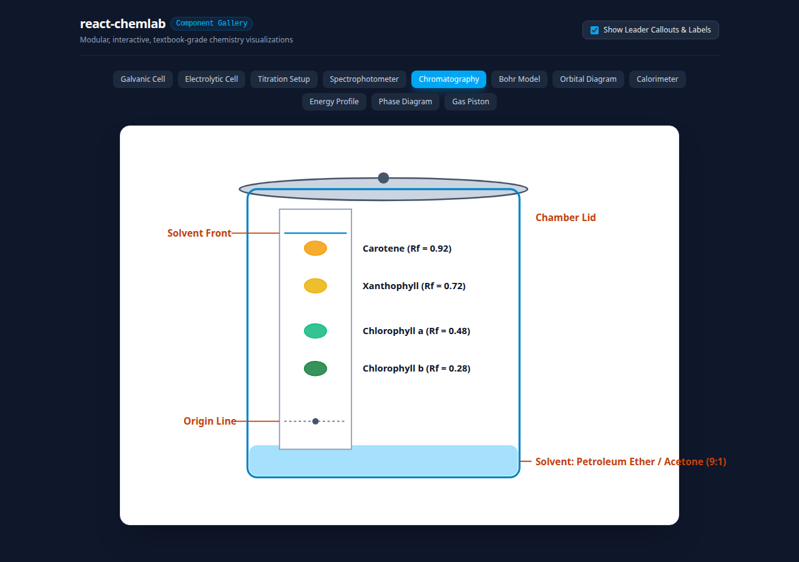 | Sealed developing chamber, solvent reservoir, TLC / filter paper strip, solvent front, separated pigment spots with calculated $R_f$ retention factors. |
| **Bohr Model** | 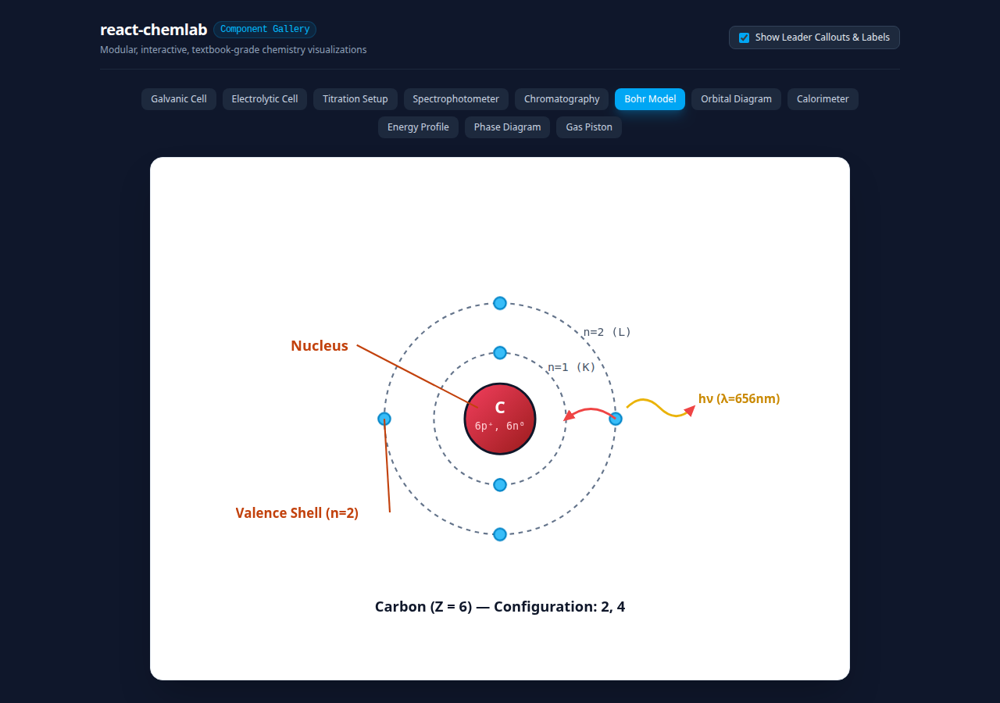 | Quantized electron shells ($n=1, 2, \dots$), proton/neutron nucleus, paired orbital electrons, emitted / absorbed quantum photon packets ($h\nu$). |
| **Orbital Diagram** | 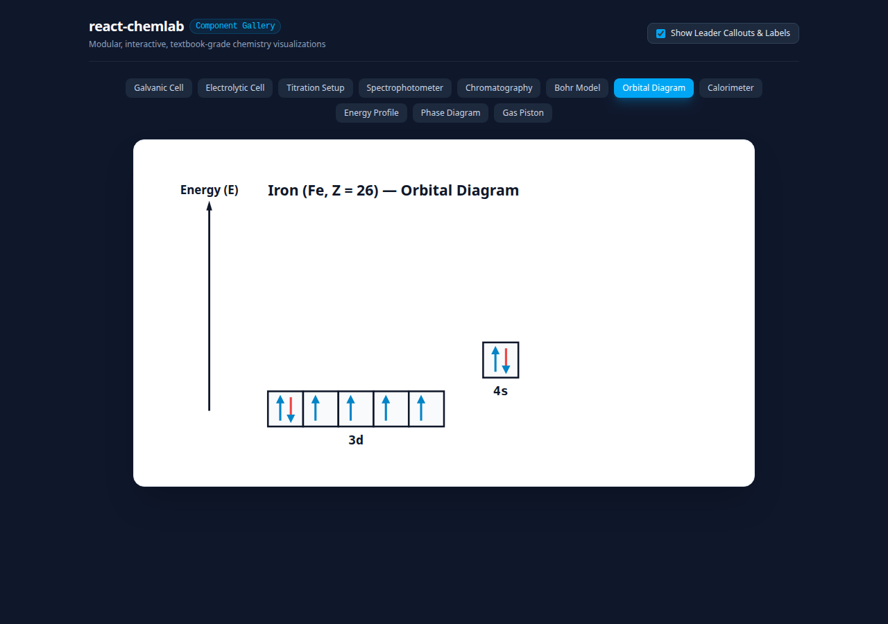 | Electron configuration energy diagram following Aufbau principle, Hund's rule, and Pauli exclusion principle ($1s, 2s, 2p, 3s, 3p, 3d, 4s$) with spin arrows ($\uparrow\downarrow$). |
| **Calorimeter** | 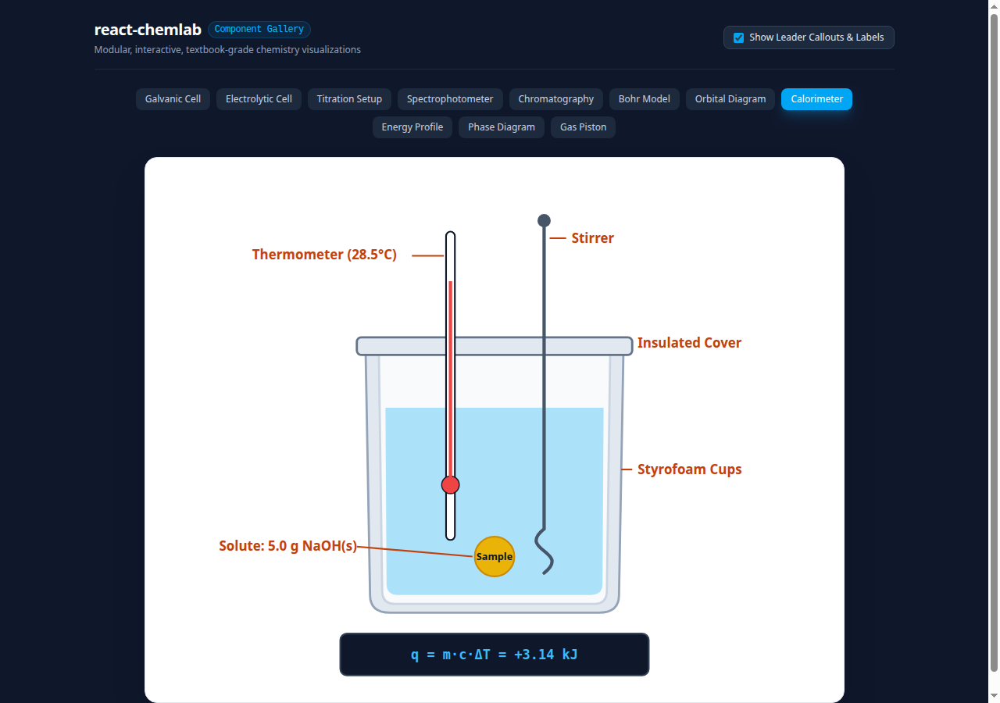 | Constant-pressure coffee cup calorimeter, double nested polystyrene insulated cups, tight lid, lab thermometer, glass stirrer, water bath ($q = mc\Delta T$). |
| **Reaction Energy Profile** | 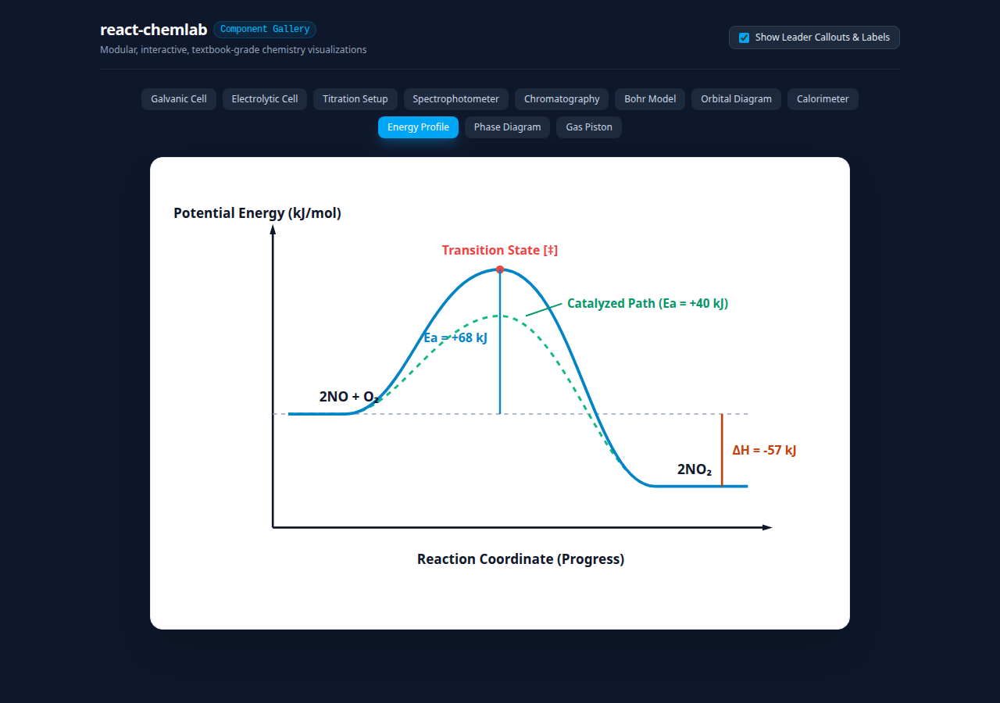 | Reaction progress coordinate vs Potential Energy curve, activation energy ($E_a$), enthalpy change ($\Delta H$), activated complex transition state ($[^\ddagger]$), catalyzed alternative pathway. |
| **Phase Diagram** | 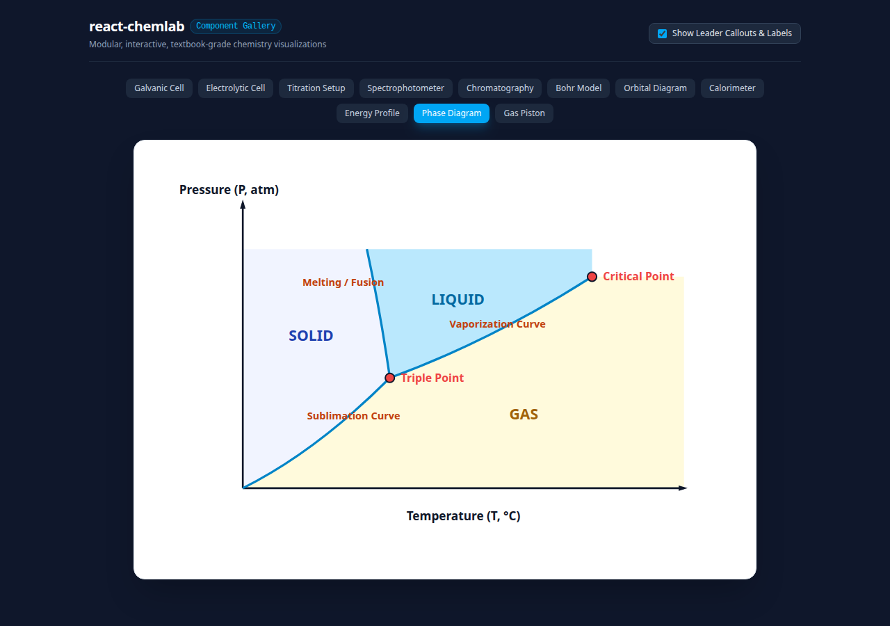 | Pressure-Temperature phase equilibrium boundaries for Solid, Liquid, Gas states, Triple Point, Critical Point, and negative-slope fusion curve for water. |
| **Gas Piston** | 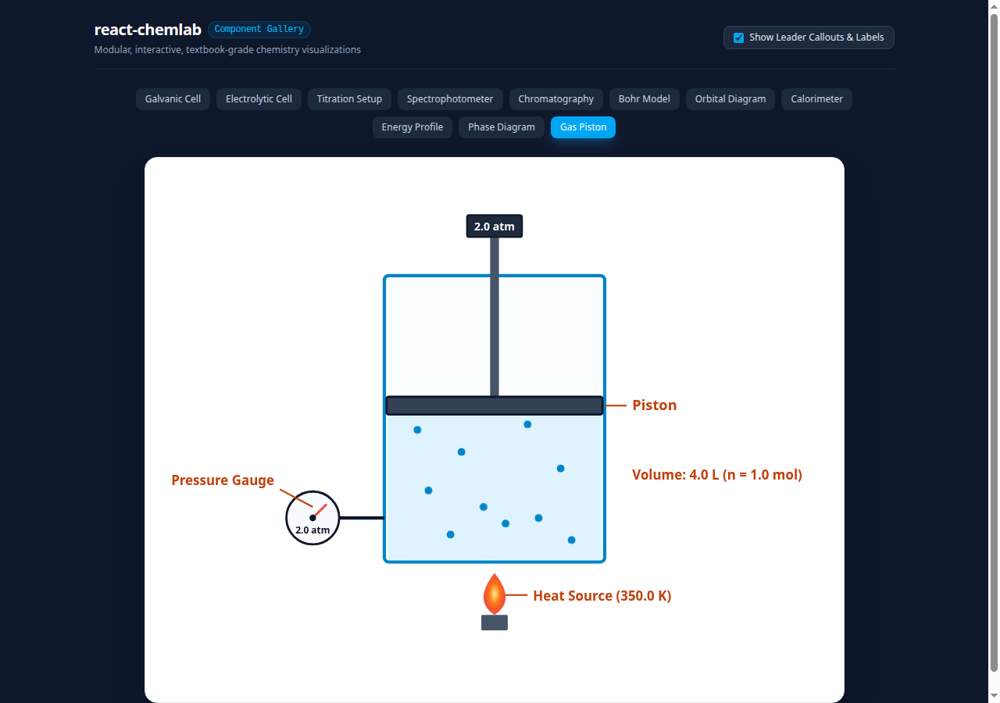 | Ideal gas law thermodynamics cylinder ($PV = nRT$), weighted piston head, dual pressure / temperature gauge, heat source, bounded kinetic gas particles. |

---

## 🚀 Getting Started

### Installation

```bash
npm install react-chemlab
```

Or with pnpm / yarn:

```bash
pnpm add react-chemlab
# or
yarn add react-chemlab
```

### Basic Usage

Import any component directly and place it inside your React component tree:

```tsx
import { GalvanicCell, TitrationSetup, BohrModel } from 'react-chemlab'

export function ChemistryApp() {
  return (
    <div className="grid grid-cols-1 md:grid-cols-2 gap-8 p-6">
      <GalvanicCell
        anodeElement="Zn"
        cathodeElement="Cu"
        voltage={1.10}
        showLabels={true}
        showCallouts={true}
        showElectronFlow={true}
      />

      <TitrationSetup
        titrant="0.100 M NaOH"
        analyte="25.0 mL HCl"
        buretteVolume="24.35 mL"
        endpointReached={true}
        showCallouts={true}
      />

      <BohrModel
        element="Carbon"
        symbol="C"
        atomicNumber={6}
        shells={[2, 4]}
        showQuantumJump={true}
      />
    </div>
  )
}
```

---

## 📖 Component API Reference

### `<GalvanicCell />`

```tsx
interface GalvanicCellProps {
  anodeElement?: string
  cathodeElement?: string
  anodeConcentration?: number
  cathodeConcentration?: number
  voltage?: number
  showLabels?: boolean
  showCallouts?: boolean
  showElectronFlow?: boolean
  animated?: boolean
  width?: number | string
  height?: number | string
}
```

### `<ElectrolyticCell />`

```tsx
interface ElectrolyticCellProps {
  voltage?: number
  current?: number
  electrolyte?: string
  anodeReaction?: string
  cathodeReaction?: string
  showLabels?: boolean
  showCallouts?: boolean
  animated?: boolean
  width?: number | string
  height?: number | string
}
```

### `<TitrationSetup />`

```tsx
interface TitrationSetupProps {
  titrant?: string
  analyte?: string
  buretteVolume?: string
  endpointReached?: boolean
  indicatorColor?: string
  showStirrer?: boolean
  showDroplets?: boolean
  showCallouts?: boolean
  animated?: boolean
  width?: number | string
  height?: number | string
}
```

### `<Spectrophotometer />`

```tsx
interface SpectrophotometerProps {
  wavelength?: number
  absorbance?: number
  transmittance?: number
  sampleName?: string
  sampleColor?: string
  showCallouts?: boolean
  animated?: boolean
  width?: number | string
  height?: number | string
}
```

### `<PaperChromatography />`

```tsx
interface PaperChromatographyProps {
  spots?: Array<{
    name: string
    rf: number
    color: string
  }>
  solvent?: string
  solventFront?: number
  showCallouts?: boolean
  animated?: boolean
  width?: number | string
  height?: number | string
}
```

### `<BohrModel />`

```tsx
interface BohrModelProps {
  element?: string
  symbol?: string
  atomicNumber?: number
  shells?: number[]
  protons?: number
  neutrons?: number
  showQuantumJump?: boolean
  jumpShell?: number
  showCallouts?: boolean
  animated?: boolean
  width?: number | string
  height?: number | string
}
```

### `<OrbitalDiagram />`

```tsx
interface OrbitalDiagramProps {
  element?: string
  electronConfiguration?: string
  subshells?: Array<{
    name: string
    boxes: number
    electrons: number
    energyLevel: number
  }>
  showCallouts?: boolean
  width?: number | string
  height?: number | string
}
```

### `<Calorimeter />`

```tsx
interface CalorimeterProps {
  reactionType?: string
  initialTemp?: number
  finalTemp?: number
  massWater?: number
  heatCapacity?: number
  heatExchange?: number
  showCallouts?: boolean
  animated?: boolean
  width?: number | string
  height?: number | string
}
```

### `<ReactionEnergyProfile />`

```tsx
interface ReactionEnergyProfileProps {
  reactantEnergy?: number
  productEnergy?: number
  activationEnergy?: number
  catalyzedActivationEnergy?: number
  showCatalyst?: boolean
  reactionLabel?: string
  showCallouts?: boolean
  width?: number | string
  height?: number | string
}
```

### `<PhaseDiagram />`

```tsx
interface PhaseDiagramProps {
  substance?: string
  triplePointTemp?: number
  triplePointPress?: number
  criticalPointTemp?: number
  criticalPointPress?: number
  isWater?: boolean
  showCallouts?: boolean
  width?: number | string
  height?: number | string
}
```

### `<GasPiston />`

```tsx
interface GasPistonProps {
  pressure?: number
  volume?: number
  temperature?: number
  gasName?: string
  particleCount?: number
  hasFlame?: boolean
  showCallouts?: boolean
  animated?: boolean
  width?: number | string
  height?: number | string
}
```

---

## 🛠️ Development & Interactive Playground

Clone this repository to run the local playground and test each component interactively:

```bash
git clone https://github.com/adhil72/react-chemlab.git
cd react-chemlab
npm install
npm run dev
```

The interactive gallery will run at `http://localhost:5173/`, where you can toggle callout lines, switch visualizers, and inspect responsiveness.

To run lint checks and production builds:

```bash
npm run lint
npm run build
```

---

## 📄 License

[MIT](LICENSE) © [adhil72](https://github.com/adhil72)
